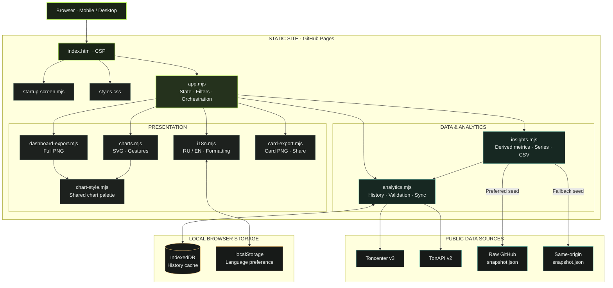
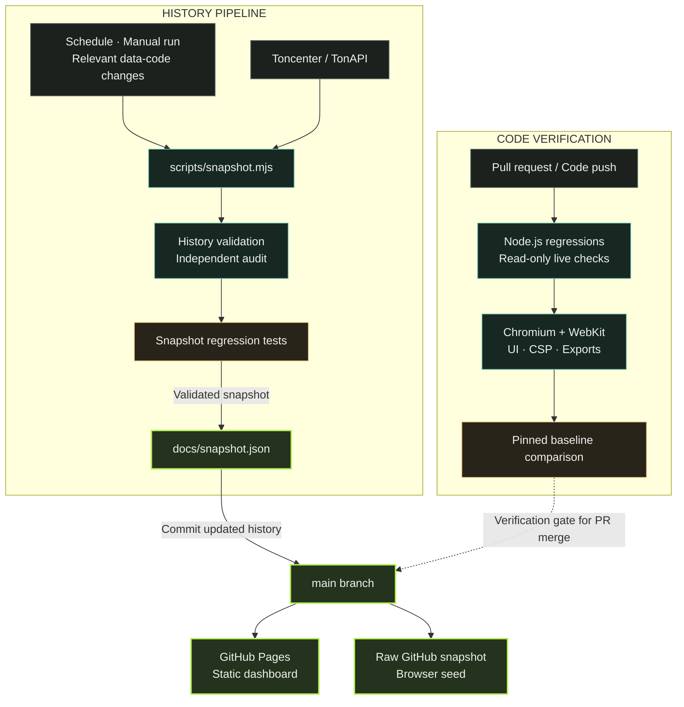

# Pepegun Analytics

Independent community on-chain analytics for the Pepegun fee collector on TON. Not an official Pepegun product.

[Open dashboard](https://drkarpov.github.io/pepegun-analytics/) · [Technical roadmap](ROADMAP.md) · [Development rules](DEVELOPMENT_RULES.md)

## Data and methodology

- Public collector: [UQD-J5lB6VMC1Cyyz2bLEEflmiG0JRXv7fccO6olayRRqWrc](https://tonviewer.com/UQD-J5lB6VMC1Cyyz2bLEEflmiG0JRXv7fccO6olayRRqWrc).
- Toncenter API v3 and TonAPI v2 supply public transaction history. Wallet counts are distinct addresses, not individual users. Gross fee revenue is incoming successful transfers classified by the accepted `Pepegun fee` comment; it is neither profit nor trade count. Venue labels are transfer-comment labels, not verified execution venues. A matching indexer does not prove business attribution.
- Amounts are integer nano-units in calculations; display rounds to four decimal places, CSV preserves exact nano-units. All time calculations use UTC. Rolling 6/24-hour presets differ from 7/30 calendar-day presets. Active-wallet 1/7/30-day windows end at the selected period's anchor. Cumulative charts include qualifying addresses since inception; interval new/returning counts use first observed qualifying activity. Return rates require a complete eligible follow-up window and a subsequent UTC day. Comparisons require a full comparable earlier interval.
- History validation checks ordered LT/hash identities and available predecessor links. Incremental client refresh validates the previous anchor. A confirmed disagreement is retained until sufficiently new valid evidence supersedes it. A transport error does not erase previously confirmed evidence. Stale/unchecked/prior/mismatch/unavailable states are distinct.
- The browser refreshes every 15 minutes while visible, using local IndexedDB and a validated raw GitHub snapshot (same-origin snapshot fallback). The scheduled/manual GitHub Actions snapshot job downloads primary history and independently cross-checks alternate history. A valid digest-bound checkpoint can reuse verified prefix evidence, with full audit fallback and full revalidation after seven days. Manual browser audit remains a full check. The checksum is not a digital signature or proof of blockchain correctness.
- Individual PNGs contain six supported card types, accurate period/anchor, material warnings when applicable, and no routine prior-history label or creation timestamp. Preview/download/share use the same PNG. Global PNG and interval CSV remain separate exports.

## Architecture

Static GitHub Pages serves `docs/`, without a server, database, runtime third-party JS dependency or paid provider.

### Browser runtime

All analytics and rendering run in the browser. The application coordinates the data layer and the UI; no private backend is involved.



Arrows show the principal runtime relationships and resource access, not every JavaScript import. The raw GitHub and same-origin seed contain the same published snapshot format. IndexedDB and language preference are stored on the device.

### Snapshot and release pipeline

Code verification and snapshot generation run separately in GitHub Actions. A documentation or UI-only change does not regenerate blockchain history.



The snapshot workflow checks transaction continuity, compares indexers and runs regressions before publishing. A detected history disagreement blocks snapshot publication; provider unavailability is recorded as a distinct audit state. The browser can continue using a validated cached or published snapshot when live sources fail.

### Module responsibilities


| File | Responsibility |
|---|---|
| `index.html`, `styles.css` | Document, responsive visual system, early meta CSP |
| `app.mjs` | Application state, range/filter controls, details/transactions, sync/audit orchestration and event wiring |
| `i18n.mjs` | RU/EN dictionary, persisted language and number/date/escaping helpers |
| `charts.mjs`, `chart-style.mjs` | SVG charts, private selection/gesture lifecycle, shared palette and opacity |
| `dashboard-export.mjs` | Global PNG renderer accepting explicit captured inputs |
| `card-export.mjs` | Individual card capture, PNG renderer, hold/preview/download/share |
| `analytics.mjs`, `insights.mjs` | Source contracts, history validation, cache, metrics, interval series and seed selection |
| `startup-screen.mjs` | Initial presentation with reduced motion and fail-open timeout |
| `snapshot.json`, `scripts/snapshot.mjs` | Published minimized history and snapshot generation |

Version module imports and HTML asset queries when their target changes. Keep dependent versions consistent. Preserve accepted v29 layout plus later reliability and startup changes. No runtime npm dependency is required.

## Browser security

The early HTML meta CSP denies resources by default. It permits local scripts/styles, inline style attributes needed by charts and venue bars (older browser fallback permits inline styles), local/blob images, and connections only to the site, Toncenter, TonAPI and the exact raw GitHub snapshot path. Inline scripts, eval, foreign scripts, unrelated connections, base changes, objects, frames, workers and forms are blocked. External links remain navigations. The static meta policy cannot enforce frame-ancestors or report-only policies; it is defense in depth, not complete XSS protection.

## Development and verification

Run from the repository root with Node.js 22:

```sh
python3 -m http.server 8000 --directory docs
# In another terminal:
for f in docs/*.mjs scripts/*.mjs tests/*.mjs; do node --check "$f"; done
node tests/analytics.test.mjs
node tests/insights.test.mjs
node tests/integrity.test.mjs
node tests/snapshot.test.mjs
# Read-only live diagnostics:
node scripts/check-providers.mjs
node scripts/check-full-history.mjs
# Actual browser tests (development dependency only):
npm install --no-save --no-package-lock --ignore-scripts playwright@1.51.1
npx playwright install --with-deps chromium webkit
node tests/p1-browser.test.mjs
git fetch --no-tags --depth=1 origin 68c8a0da7a5b4293395bdf1018f117f03e6a6a9f
node tests/p3-browser.test.mjs
# Intentional snapshot regeneration, not a UI test:
node scripts/snapshot.mjs
node scripts/snapshot.mjs --full-audit
```

Code CI runs fixed regressions, read-only live source checks and Chromium/WebKit tests. The snapshot workflow is separate and does not regenerate data for UI-only changes. The P3 comparison uses the pinned P2-07 revision with identical fixed synthetic history: RU/EN, six viewport widths, visible text/SVG, computed layout/styles, screenshot comparison, exact CSV bytes, decoded PNG pixels, preview and hold presentation. Existing browser tests cover sync/failure, audit cancellation, gestures, startup, individual exports and actual CSP enforcement. Native iOS Safari, system file sharing and clipboard permission dialogs still require device acceptance; the clipboard denial fixture is not native permission testing. Screenshots are retained as CI artifacts. Live provider rate limits or transport failures can block a run; do not publish a known failing candidate.

See [PROJECT_CONTEXT.md](PROJECT_CONTEXT.md) for current handoff and [AUDIT.md](AUDIT.md) for the original historical audit. The live task state is in ROADMAP.md.
